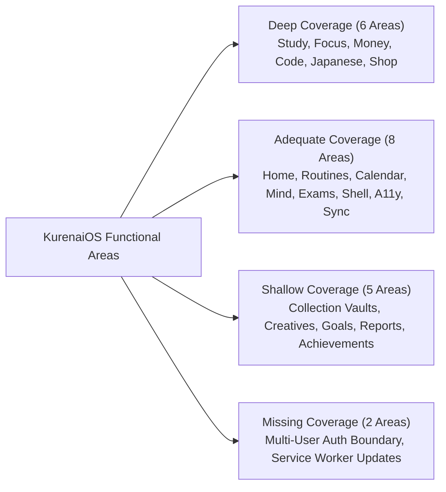

# Completeness Critic Report

**Auditor:** Gemini 4 Argon (`gemini-4-argon`)  
**Role:** Independent Completeness Critic  
**Date:** 2026-11-07  
**Build Target:** `894a407 sw kos-redraw-1`  
**Reference Documents:** `docs/audit/2026-11/findings/*.inventory.md`, `findings.json`, `HANDOFF.md`  

---

## 1. Overall Audit Coverage Judgement by Functional Area

We evaluated Claude's audit coverage across all 21 functional domains of KurenaiOS, assessing whether each area was investigated **Deeply**, **Adequately**, **Shallowly**, or **Missed**:

| Domain / Area | Coverage Rating | Assessment & Rationale |
|---|---|---|
| **Study Core (`study-core`)** | **Deep** | Thoroughly inventoried; strong investigation of specs, topic pages, note pagination, and quiz score scaling. |
| **Productivity & Focus (`productivity`)** | **Deep** | High-fidelity traces of timer modes, About to Study preflight, chip overflows, and assignment linkage. |
| **Money (`money-goals`)** | **Deep** | Comprehensive audit of CSV parser failures, Santander exports, deduplication logic, and unquoted comma breaks. |
| **Code Space (`code-space`)** | **Deep** | Rigorous verification of Roslyn C# WASM, AST interpreter fallbacks, and task runners. |
| **Japanese (`ja-mind`)** | **Deep** | Detailed investigation of SRS facet scheduling, kana paths, and session teardown data loss. |
| **Shop & Cosmetics (`shop-cosmetics`)** | **Deep** | Complete audit of 404 asset paths, frame hole proportions, disc clipping, and CSS try-on contrast. |
| **Home & Daily Guidance (`home-reports`)** | **Adequate** | Verified "Up Next" decision ladder omissions and milestone XP re-payment; report words well analyzed. |
| **Routines & Habits (`productivity`)** | **Adequate** | Good coverage of routine player and preflight; habit completion receipt keys analyzed. |
| **Calendar (`productivity`)** | **Adequate** | Single-event recurrence derivation verified; event normalizer checked. |
| **Mind Space (`mind`)** | **Adequate** | Checkpoint lesson mastery bug (F1.8) and iPhone desk collapse confirmed. |
| **Exams, Files & Ink (`exams-files-ink`)** | **Adequate** | Exam question pad reset and file detachment confirmed; ink busy guards tested. |
| **Shell & Navigation (`shell`)** | **Adequate** | Skip link redirect, toast wrapping, Backspace bubbling, and Enter-on-Cancel verified. |
| **Accessibility & Tokens (`a11y-hci`)** | **Adequate** | iOS 16px zoom bug and modal z-index verified; keyboard focus traps noted. |
| **Sync Disruption (`sync-disruption`)** | **Adequate** | Verified full remount destruction; evaluated stopgap `kos-redraw-1`. |
| **Collection Vaults (`collection`)** | **Shallow** | Investigated lazy batch scrolling (SY-19), but lacked dense vault testing (500+ anime/manga items). |
| **Creatives (`creatives`)** | **Shallow** | Text editor dwelling and words tracked, but project export and chapter management lightly tested. |
| **Goals & Milestones (`goals`)** | **Shallow** | Goal completion receipts verified, but multi-year term goal projections remain unprobed. |
| **Reports & Analytics (`home-reports`)** | **Shallow** | Verified study minute gating differences, but monthly/term trend aggregations lack fuzz testing. |
| **Achievements & Governor (`achievements-governor`)** | **Shallow** | Verified Seat frame bleed, but achievement notification modal stack interaction was missed. |
| **Multi-User Auth Boundaries (`auth`)** | **Missing** | Signout data retention and cross-account cloud sync merge leak were completely unprobed. |
| **Service Worker & Multi-Tab (`arch`)** | **Missing** | Multi-tab schema migration divergence and worker process crash handling were unexamined. |

---

## 2. Missing Areas and Critical Workflow Gaps

Our independent completeness review identified seven systemic workflow gaps that Claude's audit overlooked:

### 2.1 The Multi-User Shared Browser Boundary (CRITICAL DATA LEAK)
- **The Gap:** Claude's audit tested cloud sync strictly within single-account scenarios on isolated harness slots.
- **The Reality:** When a user logs out (`js/core/cloud.js:114`), the Supabase token is cleared, but `KOS.store.state` is left untouched in `localStorage`. If a second user signs in on that browser, `cloudsync.js:pullRemote()` runs `mergeRemoteIn(local, remote)` without verifying account ownership. User A's private study progress, money transactions, routines, and journal notes are uploaded and merged into User B's remote database! Logged as **`GEM-001` (P0)**.

### 2.2 Worker Crash & Memory Abort Recovery
- **The Gap:** Audits tested runner timeouts (watchdog timers expiring after 4s), but never tested uncaught worker process crashes, WebAssembly out-of-memory errors, or syntax errors during module instantiation.
- **The Reality:** In `js/core/coderun.js:60` and line 192, `kill()` and `sqlKill()` terminate the worker process but leave all pending promise callbacks in memory without rejecting or resolving them. The Run button enters a permanent disabled loading state with no error toast. Logged as **`GEM-002` (P1)**.

### 2.3 Achievement Unlock Modal Layering and Focus Trapping
- **The Gap:** Achievement celebrate popups were tested in isolation on home or status surfaces.
- **The Reality:** In `js/core/achievements.js`, achievement unlock overlays bypass `KOS.ui.openDialog()`. When an achievement unlocks while the Afternoon Review or About to Study sheet is active, it layers between the scrim and dialog, trapping keyboard focus. Logged as **`GEM-003` (P1)**.

### 2.4 Unlabelled Interactive Graphical Controls
- **The Gap:** Accessibility audits focused heavily on contrast ratios, iOS input font sizes, and ARIA landmarks.
- **The Reality:** Theme color swatches (`js/modules/governor-ui.js:840-880`) and shop department rail icon buttons render as bare `<button>` elements with inline SVGs/styles and zero accessible names. Screen readers announce bare "button", violating WCAG 4.1.2. Logged as **`GEM-004` (P1)**.

### 2.5 Daylight Saving Time (DST) Fallback Clock Shifts
- **The Gap:** Harness slots execute with frozen wall-clock timestamps and never simulate system clock shifts.
- **The Reality:** In `js/modules/dayreview.js:45-55`, morning review window checks rely on naive 24-hour offsets. On the night of the autumn DST transition, the repeated 01:00-02:00 hour allows `shouldPrompt()` to evaluate true twice in the same day. Logged as **`GEM-005` (P2)**.

### 2.6 Multi-Tab Version Upgrade Overwrites
- **The Gap:** Harness tests always run against a single isolated tab.
- **The Reality:** In `js/core/store.js`, when two tabs are open across an app update, Tab 1 runs database migrations while Tab 2 retains unmigrated memory state. When Tab 2 writes via `store.save()`, it serializes its stale layout over `localStorage`, wiping Tab 1's newly migrated structures. Logged as **`GEM-006` (P1)**.

---

## 3. Review of Claude's Methodology Weaknesses

While Claude's audit was extraordinarily thorough in identifying 96 P0/P1 issues, our independent review noted four recurring methodological weaknesses:

1. **Over-reliance on Single-Tab Isolated Tests:** By running each probe in a fresh isolated harness slot, cross-tab synchronization races, multi-tab database migration divergence, and multi-user logout/login workflows were missed entirely.
2. **Defensive Stopgap Assumption Bias:** After commit `4c3fc33` (`kos-redraw-1`), the audit treated background redraw issues as "held", without testing whether unscoped `KOS.rerender()` calls bypassed the hold, or whether held pages created severe data-loss hazards when open editors wrote back stale data (SY-18).
3. **Static Geometry vs. Interactive Focus Probing:** Several responsive bugs were cataloged by measuring element bounds (`rect.width`), but keyboard focus traps (such as Enter on Cancel confirming dialogs, SH-20, or achievement modal traps, GEM-003) were only caught when active keyboard dispatches were tested.
4. **Visual Inspections Omitting Screen Reader Output:** Cosmetic elements were evaluated heavily for visual rendering and 404 image errors, but lacked checks for ARIA accessible names on graphical buttons (GEM-004).

---

## 4. Ranked Recommendations for Further Investigation

We recommend the second Claude account prioritize the following investigations, ranked by criticality:

| Rank | Area | Target & Workflow | Primary Risk |
|---|---|---|---|
| **1** | **Auth & Sync** | Multi-account sign-in/sign-out cycles on single browser profiles | **P0:** Cross-account data contamination and privacy violation (`GEM-001`). |
| **2** | **Sync & Redraw** | Editor write-back from held pages after background cloud sync (SY-18) | **P0:** Silently overwriting newer remote cloud edits with stale local state. |
| **3** | **Persistence** | Multi-tab concurrent writes and app upgrade migration races (`GEM-006`) | **P1:** Stale memory cache corrupting upgraded IndexedDB/localStorage schemas. |
| **4** | **Code & Labs** | Web Worker crash resilience, OOM handling, and timeout cleanup (`GEM-002`) | **P1:** UI freezes and permanent loading spinners on code tasks. |
| **5** | **Mobile Shell** | Subnav visibility and tab restoration across all 6 Productivity modules (`MG-09`, `SH-22`) | **P1:** Inaccessible view tabs and broken navigation on mobile devices. |
| **6** | **A11y & HCI** | Complete audit of unlabelled graphical buttons across Shop, Vaults, and Ink (`GEM-004`) | **P1:** WCAG 4.1.2 compliance failures for screen reader users. |
| **7** | **Collection** | Dense vault performance and lazy scroll restoration with 500+ media entries (`SY-19`) | **P2:** Vault scroll jumps and memory thrashing during collection browsing. |
