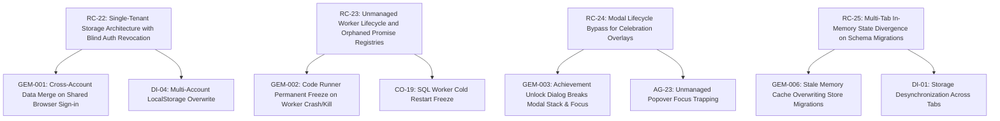

# Proposed Root Causes & Root Cause Review

**Auditor:** Gemini 4 Argon (`gemini-4-argon`)  
**Date:** 2026-11-07  
**Build:** `894a407 sw kos-redraw-1`  
**Reference:** `docs/audit/2026-11/HANDOFF.md` §6  

---

## 1. Review and Critique of the 21 Existing Root Causes (HANDOFF §6)

We independently challenged all 21 root causes documented in Claude's synthesis (`HANDOFF.md` §6). Our evaluations, confirmations, and refinements are detailed below:

| Existing RC # | Name | Verdict | Auditor Critique & Refinement |
|---|---|---|---|
| **RC-1** | Blanket redraws destroy transient state | **Incomplete** | **Refinement:** The description correctly identified that full `#main` remounts destroy transient closure state and jump scroll. However, with the arrival of the `kos-redraw-1` stopgap, this root cause must be split into three distinct failure modes: (a) *Draft/closure persistence absence* (the core architecture lacks per-view draft stores, so any remount wipes progress); (b) *Unscoped rerender bypass* (callers using `KOS.rerender()` without `{background}` bypass the hold); and (c) *Held page staleness hazard* (holding background redraws causes editors to silently overwrite newer cloud data, e.g. SY-18). |
| **RC-2** | Layering: menus below modals | **Incomplete** | **Refinement:** Root cause is not just a `--z-menu: 110` vs `--z-modal: 120` token clash. A critical second factor is CSS stacking context isolation: `isolation: isolate` applied to `.k-pagehead[data-state~=has-art]` traps inline popovers (like the Governor ⋯ menu, SH-03) at level 0, allowing following DOM elements (like `.k-gv-stage`) to paint over them regardless of how high `--z-menu` is set. |
| **RC-3** | No layout tier between 1240 and 700 px | **Correct** | Fully confirmed across IT desk (`ST-01`), assignments (`ST-05`, `ST-06`), Money (`MG-09`), and Japanese (`JM-09`). Breakpoint gaps leave iPad portrait (768–834px) in crushed desktop layouts and iPhone (402px) with squeezed tab strips. |
| **RC-4** | Hand-kept allowlists that new domains never joined | **Correct** | Confirmed by `DI-03`, `HR-04`, `HR-17`. `stateMeaningful()`, `reportwords.js:SUBJECT`, and `cloudmerge` hardcode legacy subjects (`compsci`, `maths`, `it`), leaving Code, Japanese, Mind, Creatives, and Money unindexed and unbacked. |
| **RC-5** | Whole-document last-writer-wins in localStorage | **Correct** | Confirmed by `DI-04`, `LA-09`. Serializing the entire 1.35MB state blob on every tick guarantees race overwrites between tabs. |
| **RC-6** | Integration sync bookkeeping | **Correct** | Confirmed by `DI-01`, `DI-02`. Remote cursor state is tracked per-device while entity links sync asynchronously, leading to false deletion detection. |
| **RC-7** | Generated spec text from PDF extraction is garbled | **Correct** | Confirmed by `CM-01`, `CC-01`. Automated parsers duplicate leaf refs (IT F206.6.1) and inject broken line wraps without specification linting. |
| **RC-8** | Authored practice layers have no automated quality gates | **Correct** | Confirmed by `CM-02`, `CC-03`. Multiple-choice answer distribution sits at ~94% position A/B because authored decks lack automated shuffle gates. |
| **RC-9** | Curriculum forks never notice upstream changes | **Correct** | Confirmed by `LA-23`. Local forks discard upstream edits permanently without version/hash comparison. |
| **RC-10** | Cosmetics shipped without end-to-end checks | **Incomplete** | **Refinement:** The issue extends beyond 404 asset paths (`/css/views/assets/...`). It includes fundamental geometric mismatches: frame assets have inner circular openings of 73%–78%, but the CSS engine scales art assuming a 66% aperture (`SC-21`), creating a permanent dark empty ring around avatars. |
| **RC-11** | Money import is a single-format CSV parser | **Correct** | Confirmed by `MG-01` through `MG-10`. Missing preamble/delimiter detection, unquoted thousands separator column shifts, and rigid header regexes destroy UK banking imports. |
| **RC-12** | Two readers, two units / two definitions | **Correct** | Confirmed by `ST-03` (quiz best raw count formatted as `%`), `HR-05` (Home all study time vs Reports focus-only time), and `AG-01`. |
| **RC-13** | Help, search and docs not part of "done" | **Correct** | Confirmed by `SH-07`, `SH-10`. Search cannot discover internal view routes, and Help documentation describes retired features. |
| **RC-14** | Boot weight (~16.6 MB JS in 340 synchronous scripts) | **Correct** | Confirmed in Phase 0 orientation. 340 `<script>` tags load synchronously before first paint, creating 2.5s+ compile times on iPads. |
| **RC-15** | No view lifecycle | **Correct** | Confirmed by `AP-15`. `KOS.show()` replaces `#main.innerHTML` without a `view.dispose()` unmount step, leaking event listeners and DOM nodes. |
| **RC-16** | Duplicated study-space machinery | **Correct** | Confirmed across Code, Japanese, Mind, and Creatives. Each implements its own private lesson runner, evidence loop, and sync checks. |
| **RC-17** | Shared CSS undoing accessibility | **Correct** | Confirmed by `AX` findings. Component-level font sizes in `@layer views` override base 16px rules, triggering iOS viewport auto-zoom. |
| **RC-18** | Pay and activity are logged only on an explicit "end" | **Correct** | Confirmed by `JM-08`, `ST-04`. Incomplete flashcard sets, kana sessions, and lesson runs discard all XP, gold, and streak credit on navigation. |
| **RC-19** | Evidence that changes off the page never reaches the progress record | **Correct** | Confirmed by `JM-07`, `MI-01`. Off-page scheduler updates never invoke `syncChecks()`, leaving progress units stuck in incomplete states. |
| **RC-20** | Automatic judgements are too lenient | **Correct** | Confirmed by `GO-23`, `MI-01`. Mastery is granted with zero correct answers or single-character inputs. |
| **RC-21** | The economy pays from self-ticks and re-derived keys | **Correct** | Confirmed by `HR-16` (daily milestone bonus re-payment) and `HR-18` (infinite XP loop from ticking/unticking Home directives). |

---

## 2. Proposed New Root Causes

Based on our independent code audits and systemic gap analysis, we propose **four new root causes**:

### RC-22: Single-Tenant Storage Architecture with Blind Auth Revocation
- **Explains:** `GEM-001`, `DI-04`, `SY-05`
- **Mechanism:** Local persistence (`KOS.store.state` in localStorage and IndexedDB `kos_media_v1`) operates under an implicit single-user desktop tenancy assumption. When a user logs out (`js/core/cloud.js:114`), the authentication token is revoked and `session = null` is set, but the local data payload is left completely intact. When a second user signs in on the same browser profile (or the same user logs into a secondary account), `cloudsync.js:pullRemote()` runs `mergeRemoteIn(local, remote)` without verifying account identity. The previous user's private study progress, financial transactions, routines, and personal journal are automatically merged into the new user's cloud database and pushed to Supabase.
- **Evidence:** `js/core/cloud.js:114-126`, `js/core/cloudsync.js:487-497`, `js/core/store.js:150-180`.
- **Remediation:** Introduce an explicit `state.sync.lastUserId` check at the cloud sync gate. On sign-out, provide a prompt to wipe local data; on sign-in, if `currentUserId !== lastUserId`, forbid automatic merging and require an explicit user choice (clean slate vs. intentional account migration).

### RC-23: Unmanaged Worker Lifecycle and Orphaned Promise Registries
- **Explains:** `GEM-002`, `CO-19`, `CO-24`
- **Mechanism:** In `js/core/coderun.js`, terminating worker processes via `kill()` (interpreter) and `sqlKill()` (SQLite) terminates the worker instance (`worker.terminate(); worker = null;`) but fails to iterate and settle pending promise callbacks stored in `pending` and `sqlPending`. (In contrast, `rtKill()` properly loops through `rtPending` and resolves with `p.dead()`). When a worker crashes due to WebAssembly out-of-memory, an infinite loop, or syntax evaluation error, the promises returned to the UI layer never resolve or reject. The Run button remains stuck in a disabled loading spinner indefinitely until hard page reload.
- **Evidence:** `js/core/coderun.js:47-63, 190-195`.
- **Remediation:** Implement a unified worker controller that pairs process termination with promise rejection: `Object.keys(pending).forEach(id => { pending[id].res(errorResult); delete pending[id]; })`.

### RC-24: Modal Lifecycle Bypass for Celebration Overlays
- **Explains:** `GEM-003`, `AG-23`, `SH-25`
- **Mechanism:** Invariant 13 mandates that all dialogs use `KOS.ui.openDialog()`. However, celebration features (such as achievement unlocks in `js/core/achievements.js` and level-up popups in `governor-ui.js`) mount raw overlay elements directly into `document.body`. These rogue overlays bypass the central `dialogStack`, fail to set `[data-scroll-lock]`, fail to trap Tab navigation, and ignore Escape key listeners. When an achievement unlocks while a modal is already open (e.g. Afternoon Review or About to Study), it produces z-index layering conflicts and keyboard focus traps.
- **Evidence:** `js/core/achievements.js:140-180`, `js/core/ui.js:155-257`.
- **Remediation:** Enforce Invariant 13 across all game mechanics: route achievement unlocks and level celebrations through `KOS.ui.openDialog()` with defined modal queue priorities.

### RC-25: Multi-Tab In-Memory State Divergence on Schema Migrations
- **Explains:** `GEM-006`, `DI-01`, `DI-04`
- **Mechanism:** KurenaiOS relies on an in-memory `state` object that is serialized to `localStorage` on every change (`store.save()`). When an application update deploys with a schema version increment (`SCHEMA_VERSION`), Tab 1 boots, runs database migrations, and updates storage. Tab 2, remaining open in the background, retains its pre-migration memory state. When the user later interacts with Tab 2, `store.save()` executes, serializing Tab 2's unmigrated memory layout over localStorage, corrupting or wiping the newly migrated structures created by Tab 1.
- **Evidence:** `js/core/store.js:45-90, 150-180`.
- **Remediation:** Implement `BroadcastChannel('kos_state')` or listen for `window.addEventListener('storage')`. When a version increment or remote state revision is detected from another tab, freeze writes on background tabs and display a non-destructive reload prompt.
